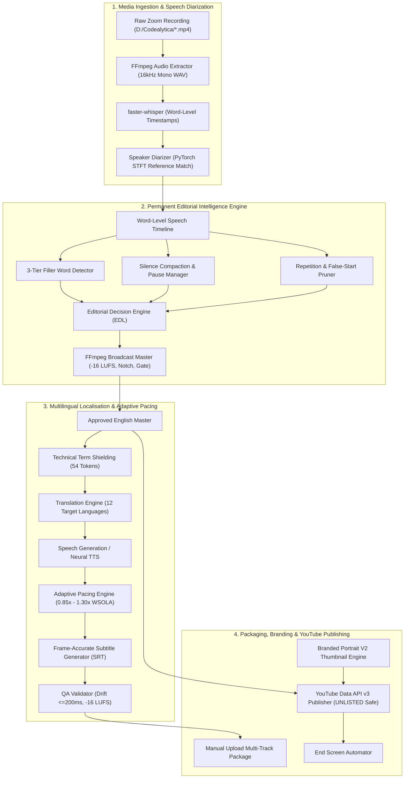

# Codealytica Editflow AI

> **Intelligent Video Post-Production. Automated Editorial Workflows. Multilingual Content Delivery.**

[](https://github.com/respectfulnrespected59-source/qmm-autoedit/actions/workflows/ci.yml)
[](https://github.com/respectfulnrespected59-source/qmm-autoedit/actions/workflows/code-quality.yml)
[](https://github.com/respectfulnrespected59-source/qmm-autoedit/actions/workflows/security.yml)
[](https://www.python.org/)
[](https://opensource.org/licenses/MIT)
[](https://github.com/respectfulnrespected59-source/qmm-autoedit/releases)

---

## 1. Product Overview

**Codealytica Editflow AI** is an extensible, automation-driven video post-production platform designed to transform raw classroom recordings, technical lectures, and instructor sessions into polished, semantically coherent educational videos with high-CTR visual assets and broadcast-standard multilingual dubbed releases.

Traditional manual post-production of hour-long software engineering classes requires tedious editing to cut dead air, filter student interruptions, remove repetitive stutters, and level audio dynamics. Editflow AI unifies speaker diarization, speech transcription, acoustic mastering, multilingual AI dubbing, subtitle alignment, and YouTube publishing into a single reproducible software platform.

---

## 2. Platform Architecture



---

## 3. Feature Catalogue

| Module | Purpose | Implementation Status | Documentation |
| :--- | :--- | :--- | :--- |
| **`core`** | Platform filesystem, logging, job persistence, manifests, and error hierarchy | :white_check_mark: Operational | [System Architecture](docs/architecture/SYSTEM_ARCHITECTURE.md) |
| **`editflow` CLI** | Unified CLI for system health diagnostics, validation, and inventorying | :white_check_mark: Operational | [Developer Guide](docs/developer/DEVELOPER_GUIDE.md) |
| **`automation/editorial`** | Permanent editorial engine: speaker separation, filler cut, pause compaction | :white_check_mark: Operational (20 tests passed) | [Editorial Engine](automation/editorial/README.md) |
| **`automation/multilingual`**| Phase 13 localisation: 12 languages, 54 protected terms, WSOLA pacing | :white_check_mark: Operational (22 tests passed) | [Multilingual Spec](automation/multilingual/README.md) |
| **`automation/youtube`** | Resumable YouTube Data API v3 publisher (strictly enforces `UNLISTED`) | :white_check_mark: Operational | [Publishing Guide](automation/youtube/README.md) |
| **`automation/thumbnail`** | High-CTR portrait V2 thumbnail compositor with instructor cutout | :white_check_mark: Operational | [Thumbnail Guide](automation/thumbnail_generation/README.md) |
| **`workers`** | Decoupled background render and analysis worker daemon stubs | :hammer_and_wrench: Worker stubs created | [Module Architecture](docs/architecture/MODULE_ARCHITECTURE.md) |
| **CI/CD Automation** | GitHub Actions CI, code quality, security scan, and release management | :white_check_mark: Configured | [GitHub Actions](.github/workflows/) |

---

## 4. Repository Structure

```text
D:\Codealytica\Editflow AI\
├── .github/                       # GitHub Actions workflows, issue templates, PR governance
│   ├── ISSUE_TEMPLATE/            # Modern GitHub Issue Forms (bug, feature, integration, docs)
│   ├── workflows/                 # CI, Code Quality, Security, Documentation, Release
│   ├── dependabot.yml             # Weekly dependency monitoring
│   └── pull_request_template.md   # Standardized Pull Request template
├── automation/                    # Core automation engines
│   ├── editorial/                 # Editorial Intelligence Engine (Diarization, cuts, mastering)
│   ├── multilingual/              # Phase 13 Multilingual Localisation (12 languages, WSOLA)
│   ├── thumbnail_generation/      # Branded Portrait V2 Thumbnail Engine
│   ├── video_processing/          # End Screen Automation and AutoEdit
│   └── youtube/                   # YouTube Data API v3 Publisher and Caption Manager
├── config/                        # Schema-validated JSON configuration and credentials
├── core/                          # Foundational platform services
│   ├── configuration/             # ConfigManager and environment loader
│   ├── error_handling/            # Custom exception hierarchy
│   ├── filesystem/                # Deterministic PathManager
│   ├── job_manager/               # Job state persistence
│   ├── logging/                   # Structured rotating logger
│   └── manifest_manager/          # SHA-256 asset manifests
├── docs/                          # Comprehensive technical documentation portal
│   ├── architecture/              # System, module, and data flow architecture
│   ├── developer/                 # Coding standards, testing, and extension guides
│   ├── github/                    # Baseline audit and implementation reports
│   ├── installation/              # Multi-platform and Windows setup walkthroughs
│   ├── operations/                # Operations, troubleshooting, and recovery manuals
│   └── security/                  # Security model and secret management policy
├── editflow/                      # Unified entrypoint CLI
├── scripts/                       # PowerShell and Python operational scripts
├── tools/                         # Video analysis and inspection utilities
├── workers/                       # Asynchronous background worker daemons
├── CHANGELOG.md                   # Semantic version changelog
├── CONTRIBUTING.md                # Developer contribution guidelines
├── LICENSE                        # MIT License
├── ROADMAP.md                     # Strategic product and engineering roadmap
├── pyproject.toml                 # Modern Python packaging configuration
└── requirements.txt               # Locked project dependencies
```

---

## 5. Quick Start & Operational Usage

### Prerequisites
- **Operating System:** Windows 10/11 64-bit or Linux Ubuntu 22.04+
- **Python:** 3.10, 3.11, or 3.12 (Validated on Python 3.12.8 64-bit)
- **FFmpeg & FFprobe:** Version 6.0+ or 7.0+ on system PATH

### Installation
```powershell
# Navigate to project root
cd "D:\Codealytica\Editflow AI"

# Activate Python virtual environment
.\.venv\Scripts\Activate.ps1

# Install locked dependencies
python -m pip install -r requirements.txt
```

### System Health & Validation
```powershell
# Execute Editflow AI health check
python -m editflow health

# Validate configuration schemas and language profiles
python -m editflow validate
```

### Running Test Suites
```powershell
# Run Editorial Intelligence test suite (20 tests)
python -m unittest discover -s automation/editorial/tests -v

# Run Multilingual Localisation test suite (22 tests)
python -m unittest discover -s automation/multilingual/tests -v
```

---

## 6. Documentation Navigation

- **[Documentation Portal](docs/README.md):** Complete guide catalog.
- **[System Architecture](docs/architecture/SYSTEM_ARCHITECTURE.md):** Architectural design, boundaries, and class relationships.
- **[Data Flow](docs/architecture/DATA_FLOW.md):** Detailed step-by-step data transformations.
- **[Windows Setup](docs/installation/WINDOWS_SETUP.md):** Native Windows installation and PowerShell configuration.
- **[Operations Guide](docs/operations/OPERATIONS_GUIDE.md):** Operational manual for processing recordings.
- **[Troubleshooting Guide](docs/operations/TROUBLESHOOTING.md):** Diagnosing common runtime errors.
- **[Security Policy](SECURITY.md):** Secret isolation and vulnerability reporting.

---

## 7. Product Roadmap

- :white_check_mark: **Phase 1–10:** Core AutoEdit & Ingestion baseline.
- :white_check_mark: **Phase 11:** Permanent Editorial Intelligence Engine (Diarization, Pause Compaction, Mastering).
- :white_check_mark: **Phase 12:** High-CTR Branded Portrait V2 Thumbnails & YouTube Automation.
- :white_check_mark: **Phase 13:** Multilingual Localisation & Adaptive Pacing (12 languages, WSOLA stretch).
- :white_check_mark: **Phase 14:** Central workspace consolidation into `D:\Codealytica\Editflow AI`.
- :white_check_mark: **Phase 15:** Enterprise-grade GitHub platform professionalization & CI/CD.
- :hammer_and_wrench: **Phase 16:** Production execution for remaining Masterclass sessions (Days 03–09).

See [ROADMAP.md](ROADMAP.md) for full sprint details.

---

## 8. Contributing & Community

Please read our [Contributing Guidelines](CONTRIBUTING.md) and [Code of Conduct](CODE_OF_CONDUCT.md) before submitting Pull Requests.

---

## 9. License

This project is licensed under the **MIT License** — see the [LICENSE](LICENSE) file for details.
