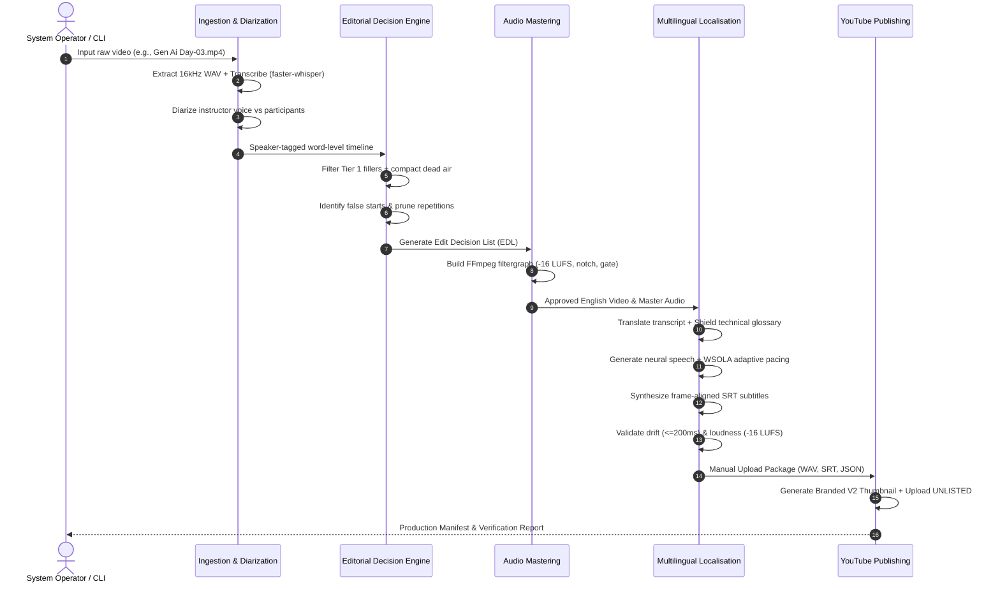

# End-to-End Data Flow Architecture

This document maps the complete data lifecycle within **Codealytica Editflow AI**, from raw Zoom classroom recordings to final YouTube deployment.

---

## 1. High-Level Pipeline Sequence

---

## 2. Detailed Data Transformation Stages

### Stage 1: Ingestion & Acoustic Characterization
- **Input:** Raw uncompressed Zoom recording (`D:\Codealytica\*.mp4`).
- **Processing:**
  - FFmpeg extracts a single-channel 16 kHz WAV track.
  - `faster-whisper` performs word-level speech-to-text with precise millisecond timestamps.
  - `SpeakerDiarizer` compares acoustic embeddings against the authorized instructor reference voice (`Lesson_01_Audio.wav`).
- **Output:** Structured JSON speech timeline containing words, start times, end times, confidence scores, and speaker attribution.

### Stage 2: Editorial Decision Making & Pruning
- **Processing:**
  - `FillerDetector` evaluates word tokens against `filler_words.json`.
  - `SilenceManager` detects dead air (> 1000 ms) and reduces duration to 400 ms.
  - `RepetitionEngine` scans forward n-grams for stutters and abandoned thoughts.
  - `EditorialDecisionEngine` harmonizes all cut decisions into an Edit Decision List (`edit_decisions.json`).
- **Output:** Validated Edit Decision List conforming to `edit_decision.schema.json`.

### Stage 3: Audio Mastering & Segment Rendering
- **Processing:**
  - FFmpeg constructs a complex filtergraph concatenating kept audio segments.
  - Audio mastering filter applies:
    - High-pass filter (80 Hz, 12 dB/octave)
    - Notch filter (50 Hz and 60 Hz mains hum removal)
    - Noise gate (-45 dB threshold, 100 ms release)
    - ITU-R BS.1770-4 loudness normalization (-16.0 LUFS, -1.5 dBTP)
  - Video cut engine splices video streams on nearest keyframes or re-encodes transition boundaries.
- **Output:** Master English lesson video (`.mp4`), standalone master audio (`.wav`), and word-aligned transcript (`.json`).

### Stage 4: Multilingual Localisation & Adaptive Pacing
- **Processing:**
  - Technical terms (e.g. `FastAPI`, `Pydantic`) are shielded using XML tags (`<token_0>`).
  - Target language text is translated and unshielded.
  - Speech synthesis generates target language audio segments.
  - `AdaptivePacingEngine` measures target audio duration against original slot duration.
  - WSOLA time-stretching adjusts audio playback speed (0.85x – 1.30x) without altering pitch.
  - Frame-accurate SubRip (`.srt`) subtitles are generated with max 42 chars/line.
- **Output:** Multi-track audio packages, localized subtitles, and validation reports.

### Stage 5: Packaging & YouTube Publishing
- **Processing:**
  - High-CTR portrait thumbnails are composited using instructor photographs, brand typography, and code overlays.
  - Metadata manager prepares video titles, educational descriptions, playlist tags, and chapter markers.
  - YouTube Data API v3 publishes video with privacy strictly forced to `UNLISTED`.
  - End screen automator links related playlist lessons and subscription cards.
- **Output:** Live YouTube video ID, update audit log, and cryptographic manifest entry.
