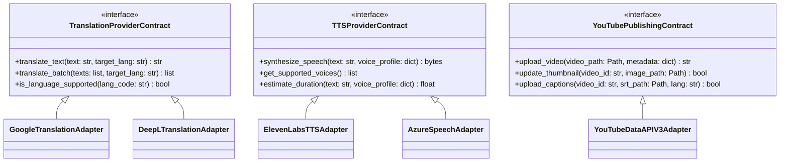

# Integration Architecture & Provider Contracts

This document specifies the integration architecture, abstract provider contracts, and external service adapters used in **Codealytica Editflow AI**.

---

## 1. Provider Abstraction Model

To maintain modularity and avoid tight coupling to specific third-party APIs, Editflow AI defines clean abstract base classes (contracts) for external services:

---

## 2. Translation Provider Contract

Location: `automation/multilingual/providers/translation_contract.py`

Every translation provider must implement:
- **`translate_text(text: str, target_language: str, source_language: str = "en") -> str`**: Translates a text string while preserving embedded technical shielding tokens (`<token_X>`).
- **`is_available() -> bool`**: Verifies provider network connectivity and credentials without consuming billable API quota.
- **`get_rate_limit_info() -> dict`**: Reports character quotas, concurrency limits, and retry backoff parameters.

### Implemented Adapters:
1. **`MockTranslationProvider`:** Used for offline test suites, CI testing, and deterministic regression testing.
2. **`GoogleCloudTranslationProvider`:** Production adapter for Google Cloud Translation Basic/Advanced API.
3. **`DeepLTranslationProvider`:** Alternative adapter for European languages.

---

## 3. Speech Synthesis (TTS) Provider Contract

Location: `automation/multilingual/providers/tts_contract.py`

Every voice synthesis provider must implement:
- **`synthesize(text: str, voice_id: str, speech_rate: float = 1.0) -> bytes`**: Generates high-fidelity linear PCM WAV audio bytes.
- **`get_voice_profile(language_code: str) -> dict`**: Retrieves configured voice pitch, stability, and speed parameters.

### Implemented Adapters:
1. **`MockTTSProvider`:** Generates mathematically valid silence/tone WAV buffers matching expected phonetic duration for fast offline unit testing.
2. **`ElevenLabsTTSProvider`:** Production adapter using cloned instructor voice profiles.
3. **`AzureSpeechTTSProvider`:** Production adapter for high-clarity multilingual neural voices.

---

## 4. YouTube Data API v3 Adapter

Location: `automation/youtube/core/`

- **Authentication:** OAuth 2.0 Installed Application flow with offline refresh tokens stored in git-ignored `config/youtube/token.json`.
- **Resumable Uploads:** Uses chunked HTTP multipart upload (`media_body=MediaFileUpload(..., chunksize=1024*1024*5, resumable=True)`) to recover from network disconnects without restarting.
- **Rate Limit & Quota Safety:** Enforces automatic exponential backoff (1s, 2s, 4s, 8s, 16s) on HTTP 403 / 500 / 503 errors.
- **Enforced Privacy Invariant:** The video privacy status is hardcoded to `UNLISTED` across all upload entry points.
