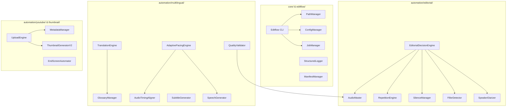

# Module Architecture & Subsystem Specifications

This document defines the subsystem boundaries, component interfaces, and module contracts of **Codealytica Editflow AI**.

---

## 1. High-Level Subsystem Breakdown

---

## 2. Core Framework Specifications (`core/`)

- **`core.filesystem.paths.PathManager`:** Resolves all system paths deterministically using `pathlib.Path`. Automatically normalizes drive letters, spaces, and workspace roots. Guarantees that raw source media roots (`D:\Codealytica`) remain read-only.
- **`core.configuration.config_manager.ConfigManager`:** Provides strongly-typed access to configuration settings, environment variables, language profiles, and schema validation.
- **`core.logging.logger.get_logger`:** Emits structured, timestamped log messages to both stdout and rotating log files (`logs/editflow.log`).
- **`core.job_manager.jobs.JobManager`:** Persists pipeline execution states in `data/job_state/<job_id>.json` enabling resumption after interruptions.
- **`core.manifest_manager.manifests.ManifestManager`:** Tracks cryptographic SHA-256 hashes of all generated audio segments, video cuts, thumbnails, and subtitle files.

---

## 3. Editorial Intelligence Engine (`automation/editorial/`)

1. **`SpeakerDiarizer`:** Identifies the instructor's authentic voice using acoustic embeddings from a reference audio sample (`Lesson_01_Audio.wav`). Classifies participant interruptions, ambient chatter, and questions for editorial exclusion.
2. **`FillerDetector`:** Evaluates speech tokens against a 3-tier hierarchy:
   - *Tier 1 (Non-semantic fillers):* `um`, `uh`, `er`, `ah` (always cut).
   - *Tier 2 (Discourse markers):* `like`, `you know`, `basically` (cut when non-pedagogical).
   - *Tier 3 (Instructional connectors):* `so`, `now`, `right` (preserved in pedagogical context).
3. **`SilenceManager`:** Detects dead air and hesitations:
   - Preserves natural conversational pauses (250 ms – 750 ms).
   - Compacts prolonged silence (> 1000 ms) down to 400 ms.
4. **`RepetitionEngine`:** Identifies stutters, single-word false starts, and repeated phrasing, retaining only the clean final delivery.
5. **`AudioMaster`:** Constructs FFmpeg filtergraphs applying de-hum (50/60 Hz notch), high-pass filtering (80 Hz), dynamic noise reduction, and ITU-R BS.1770-4 loudness normalization (-16.0 LUFS, -1.5 dBTP).

---

## 4. Multilingual Localisation Engine (`automation/multilingual/`)

1. **`TranslationEngine`:** Translates approved English transcripts into 12 target languages (es-ES, hi-IN, ta-IN, te-IN, bn-BD, mr-IN, de-DE, fr-FR, ja-JP, pt-BR, id-ID, ms-MY).
2. **`GlossaryManager`:** Shields 54 protected technical tokens (e.g. `Pydantic`, `FastAPI`, `Token`, `BaseModel`, `REST`, `JSON`) with XML delimiters preventing mistranslation.
3. **`AdaptivePacingEngine`:** Dynamically scales audio playback speed using the WSOLA algorithm (0.85x – 1.30x) to synchronize multilingual dubbed speech with the original video visual presentation.
4. **`SubtitleGenerator`:** Synthesizes frame-accurate `.srt` and `.vtt` subtitles conforming to broadcast constraints (maximum 42 characters per line, 2 lines per subtitle, 21 characters per second).
5. **`QualityValidator`:** Enforces strict QA gating: rejects dubs with timing drift > 200 ms or loudness outside -16.0 ± 1.0 LUFS.
