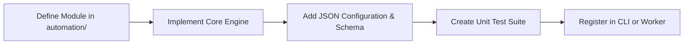

# Guide to Adding New Modules & Pipelines

This document provides a step-by-step walkthrough for extending **Codealytica Editflow AI** with new post-production tools, analysis engines, or output workers.

---

## 1. Extension Workflow Overview



---

## 2. Step-by-Step Implementation

### Step 1: Package Creation
Create a new directory within `automation/` or `tools/`:
```text
automation/scene_detection/
├── __init__.py
├── core/
│   ├── __init__.py
│   └── scene_detector.py
├── config/
│   └── scene_rules.json
├── schemas/
│   └── scene_cut.schema.json
└── tests/
    ├── __init__.py
    └── test_scene_detection.py
```

### Step 2: Implement Core Logic
Follow typing, path management, and error handling standards:
```python
from pathlib import Path
from core.filesystem.paths import PathManager
from core.logging.logger import get_logger

logger = get_logger("scene_detector")

class SceneDetector:
    def __init__(self, config_path: Path = None):
        self.paths = PathManager()
        self.config_path = config_path or (self.paths.root / "automation" / "scene_detection" / "config" / "scene_rules.json")
        logger.info(f"Initialized SceneDetector with config: {self.config_path}")

    def detect_scenes(self, video_path: Path) -> list:
        # Implementation logic
        return []
```

### Step 3: Register in Central CLI
Add your new command to `editflow/cli.py` or register a new subparser so operators can invoke it via `python -m editflow <subcommand>`.
