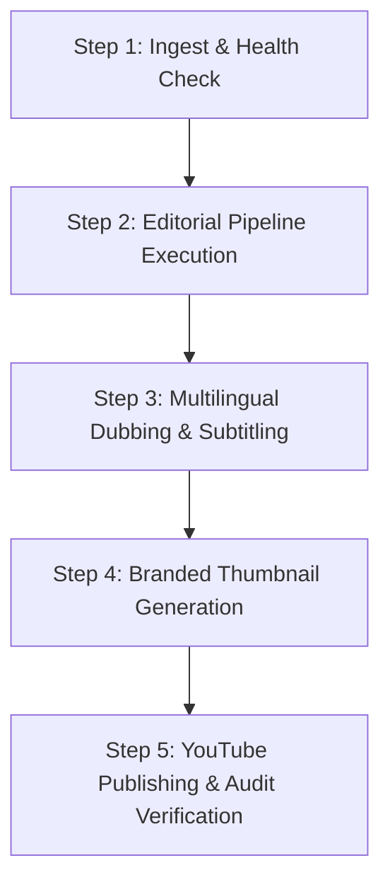

# Editflow AI Operations Manual

This guide describes standard operating procedures for operating **Codealytica Editflow AI** in production.

---

## 1. Operating Procedures Overview



---

## 2. Step 1: Pre-Flight Health Check

Before running processing pipelines on large video recordings:

```powershell
cd "D:\Codealytica\Editflow AI"
.\.venv\Scripts\Activate.ps1
python -m editflow health
python -m editflow validate
```

Verify that all dependencies (FFmpeg, faster-whisper, PyAV, SoundFile) report `READY` and sufficient disk space is free (> 50 GB).

---

## 3. Step 2: Running Editorial Post-Production

To process a raw classroom recording (e.g. `Gen Ai Day-03.mp4`):

```powershell
python -m automation.editorial.core.pipeline_orchestrator `
    --input "D:\Codealytica\Gen Ai Day-03.mp4" `
    --output-dir "D:\Codealytica\Enhanced_Videos\Day_03" `
    --reference-audio "D:\Codealytica\Enhanced_Videos\Day_02\Audio_Master\Lesson_01_Audio.wav" `
    --mode full
```

### Modes:
- `--mode full`: Executes transcription, diarization, filler removal, pause compaction, audio mastering, and video cutting.
- `--mode audio-only`: Generates audio masters and transcript without rendering video cuts.
- `--mode analyze`: Generates Edit Decision List (EDL) without modifying or rendering media.

---

## 4. Step 3: Multilingual Localisation & Dubbing

To generate a localized audio and subtitle package for a specific lesson:

```powershell
python automation/multilingual/scripts/generate_dub.py `
    --input "D:\Codealytica\Enhanced_Videos\Day_02\Audio_Master\Lesson_01_Audio.wav" `
    --language "es-ES" `
    --output-dir "D:\Codealytica\Enhanced_Videos\Multilingual\Day_02\Lesson_01"
```

To validate compliance with broadcast standards (-16.0 ± 1.0 LUFS, timing drift ≤ 200 ms):

```powershell
python automation/multilingual/scripts/validate_dub.py `
    --manifest "D:\Codealytica\Enhanced_Videos\Multilingual\Day_02\Lesson_01\manifest.json"
```

---

## 5. Step 4: Generating Branded Thumbnails

To generate high-CTR portrait thumbnails featuring the instructor's real photograph:

```powershell
python automation/thumbnail_generation/generate_thumbnails_v2.py
```

Thumbnails will be generated in `automation/thumbnail_generation/output_portrait_v2/` with preview contact sheets in `automation/thumbnail_generation/previews_v2/`.

---

## 6. Step 5: Publishing & Manual Multi-Audio Track Ingestion

1. Upload English master video and metadata to YouTube:
   ```powershell
   python automation/youtube/scripts/cli_publisher.py --manifest "config/youtube/DAY01_UPLOAD_MANIFEST.json"
   ```
2. Note: All automated uploads are forced to `UNLISTED`.
3. To attach secondary multi-language audio tracks (`.wav`) and subtitles (`.srt`), operators use the generated **Manual Upload Package** in `D:\Codealytica\Enhanced_Videos\Multilingual\<Lesson>\youtube_manual_upload_package\`. Open YouTube Studio → Subtitles / Audio Tracks and upload the corresponding `.wav` and `.srt` files.
