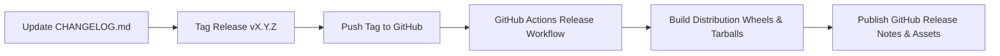

# Release Process & Versioning Standards

This document describes the release engineering cycle, semantic versioning policy, and distribution workflow for **Codealytica Editflow AI**.

---

## 1. Semantic Versioning (SemVer 2.0.0)

Editflow AI strictly adheres to [Semantic Versioning 2.0.0](https://semver.org/):

$$\text{MAJOR}.\text{MINOR}.\text{PATCH}$$

- **MAJOR (`X.0.0`):** Incompatible API changes, major architectural refactorings, or breaking CLI changes.
- **MINOR (`1.X.0`):** Backward-compatible new features, new provider adapters, or editorial algorithms.
- **PATCH (`1.0.X`):** Backward-compatible bug fixes, performance improvements, or documentation updates.

---

## 2. Release Lifecycle & Steps



### Execution Steps
1. **Prepare Release in Local Workspace:**
   - Update `CHANGELOG.md` with version header, release date, and detailed bullet points.
   - Update version string in `pyproject.toml` and `core/__init__.py`.
   - Run full test suite:
     ```powershell
     python -m unittest discover -s automation/editorial/tests
     python -m unittest discover -s automation/multilingual/tests
     ```
2. **Commit and Tag:**
   ```bash
   git commit -am "chore(release): prepare v1.0.0"
   git tag -a v1.0.0 -m "Release v1.0.0: Editflow AI Platform"
   ```
3. **Trigger GitHub Release Workflow:**
   ```bash
   git push origin v1.0.0
   ```
4. **Automated GitHub Action (`release.yml`):**
   - Automatically builds source distribution (`sdist`) and wheel (`bdist_wheel`).
   - Extracts release notes from `CHANGELOG.md`.
   - Creates an official GitHub Release with binary assets attached.
