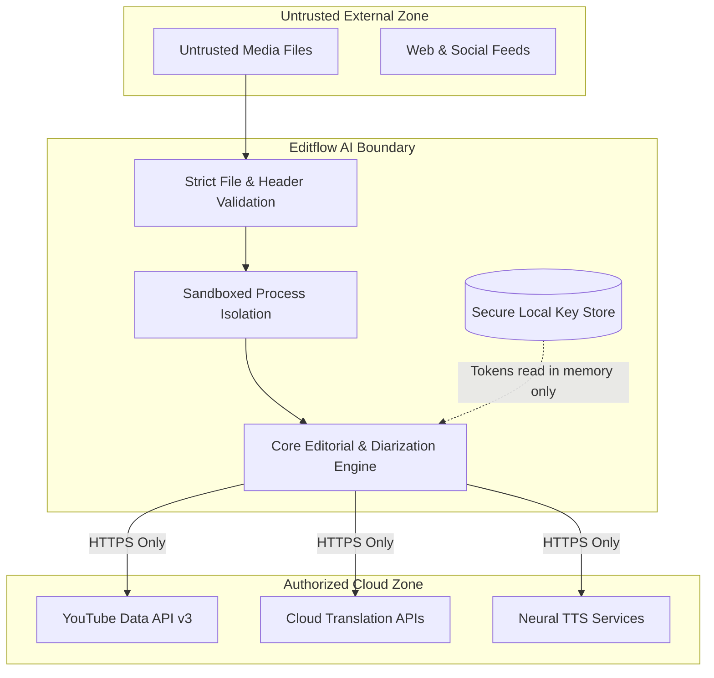

# Security Model & Threat Boundary Architecture

This document describes the security architecture, trust boundaries, subprocess isolation, and defense-in-depth mechanisms employed by **Codealytica Editflow AI**.

---

## 1. Security Architecture & Threat Boundaries

---

## 2. Core Security Controls

### A. Subprocess & Command Execution
- No shell injection vectors: All subprocess invocations (FFmpeg, FFprobe) pass structured list arguments (`["ffmpeg", "-i", str(input_path), ...]`) rather than evaluating unescaped shell strings with `shell=True`.
- Working directories are explicitly constrained to project paths.

### B. Media Sanitization & Ingestion Boundaries
- Video files undergo FFprobe structural validation prior to FFmpeg filter execution to detect corrupted containers or malicious header payloads.
- All paths are normalized via `pathlib.Path.resolve()` to prevent directory traversal (`../`) attacks.

### C. Network & API Transport
- All communication with external services (YouTube Data API, Google Cloud Translation, ElevenLabs, Azure Speech) is conducted strictly over TLS 1.3 encrypted HTTPS connections.
- Plaintext HTTP endpoints are forbidden.
